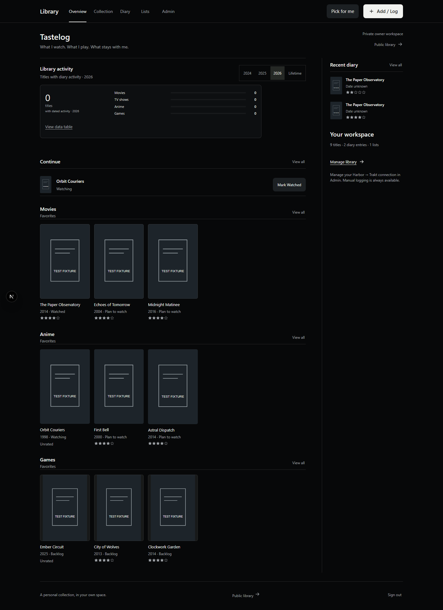
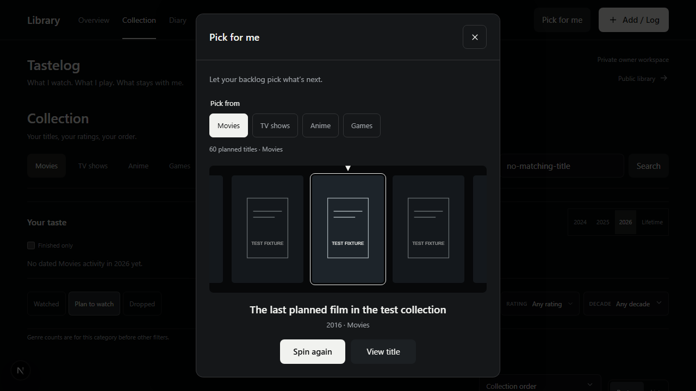

# Tastelog

Your taste, logged. A self-hosted personal library for movies, TV, anime, and games.

Keep a collection, rate titles with half stars, write a diary, organize lists, and pick your next watch or play from your backlog. Each installation belongs to one owner; visitors see only the titles, diary entries, and lists you choose to publish.



## Features

- Movies, TV, anime, and games in one collection, with poster and list views.
- Search, genre/status/rating/year filters, sorting, and shareable view URLs.
- Five-star ratings with half stars; current ratings and diary ratings stay separate.
- Diary entries, reviews, favorites, ordered lists, and recoverable removal.
- Activity statistics by year or lifetime.
- **Pick for me**: a spinning poster reel that fairly picks from your planned titles.
- Optional TMDB, MyAnimeList, and IGDB catalog search, using your own credentials.
- Optional Trakt connection with explicit watch-history review and private imports.
- Full JSON backups and restore, plus collection CSV export.
- Owner login through Supabase, with separate private and public database documents.
- Keyboard controls, reduced motion, and responsive phone layouts.

Installs start empty. No real collection, account, API credentials, or personal poster mappings are included. Screenshots use fictional test data and original placeholder artwork.

## Quick start

Requires Node.js 24 or newer and npm. Supabase is required for login and saving. Catalog APIs and Trakt are optional.

```sh
git clone https://github.com/8valet/tastelog.git
cd tastelog
npm ci
```

Copy `.env.example` to `.env.local`:

```sh
# macOS / Linux
cp .env.example .env.local
```

```powershell
# Windows PowerShell
Copy-Item .env.example .env.local
```

Follow [database and owner setup](docs/setup.md), then run:

```sh
npm run dev
```

Open [localhost:3000](http://localhost:3000). The home route opens `/library`; sign in at `/admin/library`. Without database settings, the app shows setup instructions and does not save data.



## Configuration

| Variable | Purpose | Required |
| --- | --- | --- |
| `NEXT_PUBLIC_LIBRARY_NAME` | Library title; defaults to Tastelog | No |
| `NEXT_PUBLIC_LIBRARY_DESCRIPTION` | Short description beneath the title | No |
| `SITE_URL` | Absolute origin, such as `https://library.example.com` | Set for production |
| `NEXT_PUBLIC_SUPABASE_URL` | Your Supabase project URL | For saving |
| `NEXT_PUBLIC_SUPABASE_PUBLISHABLE_KEY` | Your Supabase publishable key | For saving |
| `LIBRARY_OWNER_ID` | UUID of your allowlisted Auth user | For saving |
| `TMDB_READ_TOKEN` | Movie and TV catalog access | No |
| `MAL_CLIENT_ID` | MyAnimeList anime catalog access | No |
| `TWITCH_CLIENT_ID`, `TWITCH_CLIENT_SECRET` | IGDB game catalog access | No |
| `TRAKT_CLIENT_ID` | Trakt application client ID | No |
| `TRAKT_REDIRECT_URI` | Your HTTPS origin + `/api/library/trakt/callback` | With Trakt |
| `TRAKT_ENCRYPTION_KEY` | Stable 32-byte key encoded as 64 hex characters | With Trakt |

Keep provider secrets on the server. Only presentation settings and the Supabase URL/publishable key use `NEXT_PUBLIC_`. No Supabase service-role key is needed. Rebuild after changing public settings.

See [catalog and Trakt configuration](docs/integrations.md), [deployment](docs/deployment.md), and [architecture](docs/architecture.md).

## Development

```sh
npm test                    # Model, database, privacy, backup and integration logic
npm run lint
npm run typecheck
npx playwright install chromium
npm run test:library:e2e     # Isolated browser flows on ports 3211/3212
npm run build
npm start
npm run check:release        # Scan tracked release files for excluded material
```

The browser fixture runs its own synthetic authentication service and PGlite database. It never connects to your Supabase project or live catalog APIs. Test credentials are deliberately fake and are used only by the separate test process. Test results do not prove live provider availability or email delivery.

Edit `app/(en)/library/library-base.css` and `library-additions.css` for styling. `npm run build:library-css` compiles them into `library.css`; production builds run it automatically. The `(en)` route group organizes files and does not appear in URLs.

## Scope

Tastelog is a single-owner application, not a multi-user hosted service. Each person deploys their own copy and supplies their own database and API settings. It does not include public signup, automatic tracker sync, Steam achievements, or episode-level synchronization. Trakt imports require review and never write back to Trakt. Third-party tracker exports need conversion to the versioned Tastelog backup schema; there is no general Letterboxd/MAL/Backloggd import wizard.

The state is a bounded JSONB document: up to 5,000 titles, 20,000 diary events, and 1,000 lists. UI backups are limited to 5 MB. See the architecture guide before expanding these bounds.

## License and credits

Application code and original placeholder artwork are [MIT licensed](LICENSE), copyright 2026 [8valet](https://github.com/8valet). Third-party providers, metadata, posters, and trademarks retain their respective rights and terms; the MIT license does not grant rights to their content. The bundled Trakt logo is provider attribution artwork, not original application art. See [third-party notices](THIRD_PARTY_NOTICES.md).

Tastelog was extracted from the author's personal portfolio library into a standalone application. The public repository starts with fresh history and contains no original account configuration or records.
